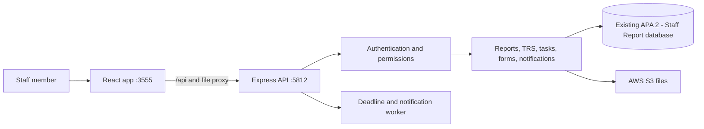

# Application flow

The frontend loads through the App2 server. The backend checks the signed-in user and permissions before operating on application data. Both local development and the single PM2 deployment use the App2 profile and the existing APA 2 database.
