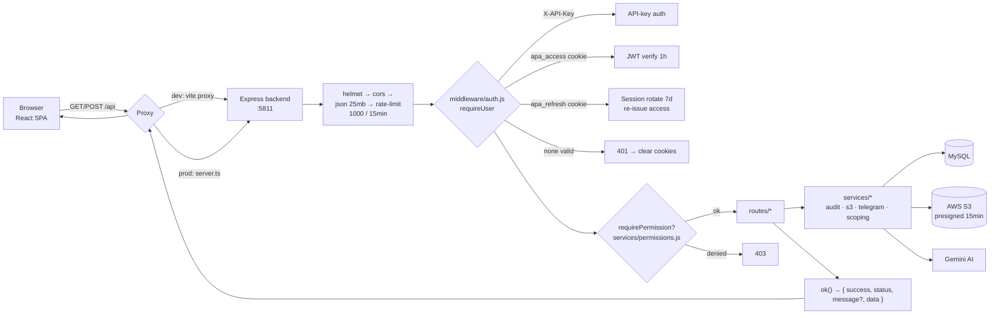
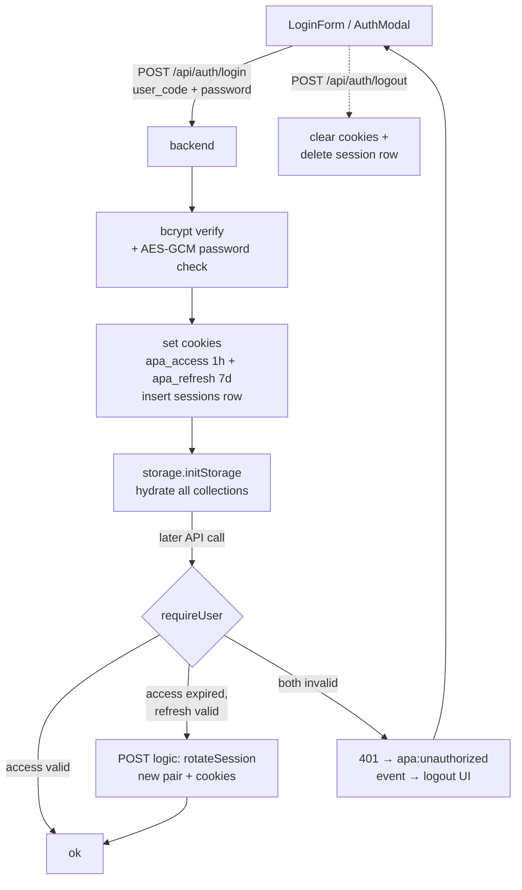
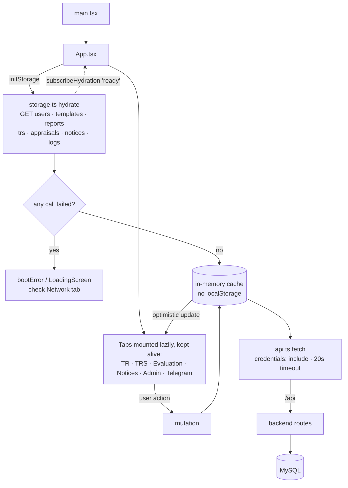
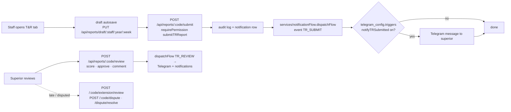
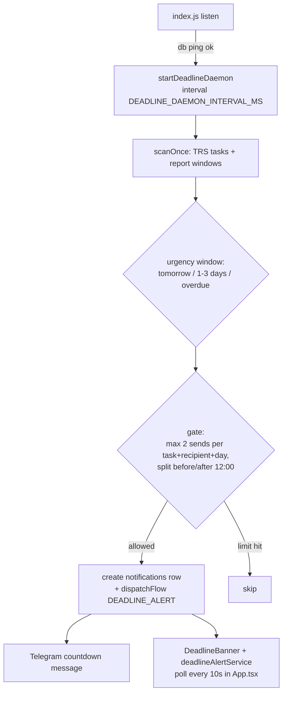
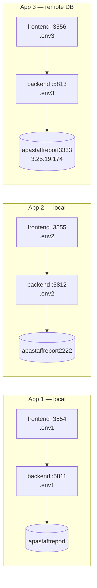

# APA Staff Report — Flowcharts

## 1. Request Flow (Browser → Backend)



- **Public (no auth):** `/api/health`, `/api/auth/login|session|refresh`, `/reportupload/*` files.
- **Everything else** in `routes/index.js` sits behind `requireUser`.
- Errors thrown anywhere → `asyncHandler` → `errorHandler` (single JSON shape).

---

## 2. Login & Session Lifecycle



Forced password change: `POST /api/auth/check` → `ForcePasswordChange.tsx` blocks the app until resolved.

---

## 3. Frontend Boot & Data Flow



Rules: views never mount before hydration is `ready`; every write goes to the API **and** the cache (`storage.ts` mirrors the old local-first API surface).

---

## 4. Report Submit → Review → Notify



Same pattern for TRS tasks (`/api/trs/*`) and appraisals (`/api/appraisals/*`) — route → permission → audit → `dispatchFlow`.

---

## 5. Deadline Daemon & Reminders



Frontend also polls `getStaffDeadlineAlerts()` every 10s — if banners are wrong, check `services/deadline.js` windows and `deadlineAlertService.ts`.

---

## 6. Backend Boot Sequence (`backend/index.js`)

```mermaid
flowchart TD
    S[index.js start] --> ENV[config/env.js<br/>dotenv: ENV_FILE or .env]
    ENV --> MW[helmet → cors(origin list) → json →<br/>cookie-parser → rate-limit /api]
    MW --> RT["routes mounted at /api (routes/index.js)<br/>+ public files router (reportupload)"]
    RT --> ERR[notFoundHandler → errorHandler<br/>must be LAST]
    ERR --> L["app.listen env.PORT (5811)"]
    L --> P[pingDatabase]
    P -->|ok| D2[startDeadlineDaemon + log db: connected]
    P -->|fail| LOG["log db: FAILED, skip daemon<br/>(app still serves, queries will error)"]
```

---

## 7. Multi-Instance Map



> Both sides of an instance must use the **same** `.envN`, otherwise the frontend talks to the wrong DB.
> Prod builds: `build1/2/3` → `dist/dist2/dist3`, served by `server.ts/2/3` on 3554/55/56 via PM2.
